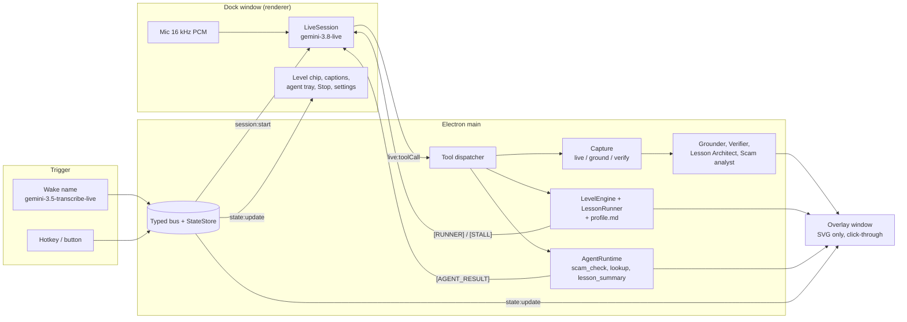

# Alongside

**The assistant that's trying to get fired.**

Alongside is a voice-activated companion that lives on your own screen and *teaches* you to use a computer instead of doing it for you. Say its name and it draws the next step on your real screen (an arrow and a ring with the step number), checks with a fresh look at the screen that you actually did it, and then helps a little less each time. Every other assistant tries to be needed. Alongside measures its success by how few hints you need: the progress view plots **hints per task** going down. It is built for older adults, people with low digital confidence, low vision or dyslexia, and for the family members who get the panicked phone calls. It also reads a suspicious text with you and points at the exact phrases that look like a scam, without ever telling you a message is "safe".

Built on 31 Oct 2026 for the Google DeepMind x Imperial hackathon (Gemini Edition). English only, macOS first, primary display only.

> Persona names (wake words, voices, accent colours) are placeholders configured in one file: [`src/shared/personas.ts`](src/shared/personas.ts).

---

## The problem

<!-- VERIFY BEFORE PRESENTING: re-open both sources below and re-check every figure before it goes on a slide or is said on stage. Both were marked [V] (read at the primary page) in research/04 on 31 Oct 2026. Do not add figures that are not in this list. -->

- **Age UK, 3 Sep 2026** (ELSA 2023-24 data): **13%** of over-65s in England are digitally excluded and **25%** are partially excluded. Of the excluded, **49%** say their IT skills are not good enough and **30%** distrust the internet because of fraud and data worries.
  Source: [Age UK press release](https://www.ageuk.org.uk/latest-press/articles/age-uk-unveils-ground-breaking-analysis-of-where-our-older-population-is-on-the-digital-inclusion-spectrum-and-calls-on-the-government-to-get-digital-done-right/).
- **Good Things Foundation, Digital Nation 2026:** **8 million** adults lack basic digital skills and **2.2 million** are offline.
  Source: [Digital Nation](https://www.goodthingsfoundation.org/policy-and-research/research-and-evidence/research-2024/digital-nation).

The usual answers either do the task *for* you (remote support, computer-use agents), which teaches nothing and is exactly what scammers abuse, or answer one question and forget you. A volunteer Digital Champion is patient and remembers you, but is not there at 11pm when you are stuck. Alongside tries to be that patient person: one step at a time, remembering what you can already do, and stepping back as you improve.

## What it does

| Feature | What you see |
|---|---|
| **Help ladder, with fading** | Four levels per skill: **L1 Watch me** (a ghost cursor demonstrates; it never clicks), **L2 Walk with me** (one arrow + a numbered ring per step, tick before the next), **L3 Nudge me** (goal only; if you stall: soft glow, then a spoken clue, then an arrow), **L4 On my own** (silent unless harm is imminent). A level chip on screen shows where you are. **Help also fades inside a lesson**: after two clean steps in a row the level eases up by one (never more than one above where the attempt started) and the drawings stop; after two struggling steps in a row it comes back. Plain deterministic code (`src/main/teaching/levels.ts`) decides the level, not the language model, so a chatty model cannot talk the product out of fading. |
| **Verification loop** | After a step, Alongside takes a fresh full-resolution look at the screen and checks the expected outcome. Right: a tick. Wrong tap: a calm repair hint and the target highlighted again. Not sure: "I can't quite see that. What do you see?" It never guesses a button location. |
| **Scam Shield** | Ask "is this text a scam?" A background agent reads the message (given text or the screen), has three Flash specialists and then Argon assess it, gets a verdict and red flags, and highlights the exact phrases on screen with a plain reason each. It never says a message is safe, and always points to a human check (the number on the back of your bank card, Age UK). Text that tries to give orders to an AI is itself reported as a red flag. |
| **Spawned agents** | By voice, helpers run in the background and show as chips in the agent tray: `scam_check`, `lookup` (a factual question), `lesson_summary` (a summary-only note for a carer, only if carer sharing is on). At most three at once; each has a timeout and can be cancelled. |
| **A learner profile you own** | One readable Markdown file (`profile.md`): skills and levels, confidence log, attempt history, what works for you, jargon to avoid, who can see what. You can edit or delete any line; a stale write is rejected so your edit always wins. It powers the memory callback ("Yesterday you practised start a video call. Found the green Start call button with one hint."). |
| **Teach-back** | After a task: say it back in your own words; if it is wrong, Alongside rephrases with a different comparison; one "point to it" question; a 1-5 confidence rating. |
| **Progress you can see** | "Things you can do now", per-skill level, confidence trend, and the **hints-per-task chart**, the anti-dependency evidence. |
| **Accessibility settings** | Captions or text-only, voice speed, big annotations, high contrast, dyslexia-friendly font, jargon explanations, gentle or fast pacing. |
| **First-run setup** | A skippable nine-screen get-to-know-you flow (name, help topics, pace, comfort settings, look, helper voice, permissions with live status, how much it may do for you, ready). Re-run it from "Set up again". On a fresh profile it opens first and keeps the dock open until finished or skipped. Checked in a browser gallery and unit tests; not yet in a real Electron window with real macOS prompts. |
| **Chat and a calmer look** | Type instead of talking (text mode: no microphone, replies as chat bubbles), light, dark or system theme, optional glass (translucent) dock, text size, dyslexia font. Menu-bar item with Talk, Type, Mute, Stop, Show/Hide, Permissions (real-run checked: 22 of 22 checks, `docs/reports/SHELL.md`). |
| **Optional: do small things for you (off by default)** | `open_for_me` opens one website, app, indexed file or settings pane after you press Yes in a window the model cannot press. `act_for_me` (a short multi-step task) is **switched off in this build** unless `ALONGSIDE_AGENCY_LOOP=1`, and no real click or keystroke has been run yet. Details and limits: [docs/AGENCY.md](docs/AGENCY.md). |
| **Optional: search your files (off by default)** | After you pick folders in a native dialog, a local index lets the assistant answer "where is my ...?" with short snippets (`search_files`, read-only). Off until switched on in settings. See "Trust and control" for what is sent to Google. |

Three skills are built (not a whole tree): **start a video call**, **spot a scam message**, **make the text bigger** (`src/main/teaching/skills/definitions.ts`).

## Why it needs Gemini 4 Argon

Be precise about the split, because it is the honest architecture: **`gemini-4-argon` cannot do the talking.** It has no Live API and returns text only. The voice-and-vision loop runs on **`gemini-3.8-live`**, which listens, speaks, sees ~1 frame per second of the screen and can be interrupted. Argon does the thinking that has to be right, behind tool calls. Three Argon jobs are built:

1. **Scam Shield orchestration** (`src/main/gemini/scam-analyst.ts`). Three `gemini-3.8-flash` specialists run in parallel with one narrow job each (the links, with URL context and Search when a link is present; the wording and pressure; the sender and impersonation). Then Argon reads the message plus their findings, resolves where they disagree and writes the final report. If Argon fails or runs out of time, the specialists' findings are merged deterministically into a conservative report (never "likely genuine"). Code, not the prompt, guarantees that red-flag phrases are verbatim from the message, that nothing is called "safe", and that a human check is always offered. This is the only place Argon orchestrates other models.
2. **Verification disputes** (`src/main/gemini/verifier.ts`). Verification is tiered: `gemini-3.5-flash-lite`, then `gemini-3.8-flash`, then Argon, escalating only when a tier is unsure (confidence under 0.8 or `uncertain`). If nobody is sure the answer is "not certain", never a tick.
3. **Lesson Architect for goals we did not hand-write** (`src/main/gemini/lesson-architect.ts`). The three built-in skills start instantly from hand-written plans (fast, deterministic, matched to the practice desktop). For any other goal Argon plans up to four steps from the live screenshot: each has a visual `targetDescription`, an `expectedOutcome` (the verifier's contract), three graded hints and a `safetyCritical` flag that code can force on for risky wording. Step 1 is checked against the real screen and the plan is redone once if it is not visible. If planning fails, Alongside says so and just points; it never runs a wrong lesson. This path is benchmarked but is not part of the three-minute demo.

**Not built:** Argon orchestrating the Lesson Architect or the verifier. Which helper to start is chosen by the Live model through `spawn_agent` and run by the plain-code `AgentRuntime`.

| Role | Model (ID from `src/shared/models.ts`) | Notes |
|---|---|---|
| Voice, listening, screen frames, tool calls | `gemini-3.8-live` | Persona voice fixed per session; context compression + resumption on; ephemeral token minted in main, the real key never reaches a renderer |
| Scam synthesis, last-tier verification, novel-goal lesson plans | `gemini-4-argon` | Text-only; no `temperature/top_p/top_k` (uses `thinking_level`); never on the hot path |
| Scam specialists, grounding escalation and "precise" grounding, mid-tier verification, `lookup` and message-reading agents | `gemini-3.8-flash` | `box_2d` grounding; a computer-use **dry run** is the last fallback and only yields a click point: nothing is ever executed |
| Grounding (fast pass), first-tier verification, routing | `gemini-3.5-flash-lite` | Lowest latency on the hot path |
| Wake-name spotter | `gemini-3.5-transcribe-live` | Streaming transcript + fuzzy name match; hotkey and button always work |

Override any of these with `MODEL_LIVE`, `MODEL_FLASH`, `MODEL_LITE`, `MODEL_ARGON`, `MODEL_TRANSCRIBE` (read only in `src/shared/models.ts`). Every call that carries a screenshot is sent with `store:false`.

## Architecture



- **Two windows.** `dock`: a small always-on-top panel that hosts the mic, the Live session and the wake spotter (`backgroundThrottling:false`). `overlay`: full-screen, transparent, click-through, above everything, SVG annotations only, no controls.
- **One dispatcher.** Every Live tool call (`point_at`, `start_lesson`, `step_done`, `verify_step`, `set_help_level`, `spawn_agent`, `ask_user_confirm`, `update_profile`, `end_lesson`, `clear_annotations`, plus the opt-in `do_it_for_me`, `open_for_me`, `act_for_me`, `search_files`) goes through `src/main/tools/dispatcher.ts`, the same code the dev HTTP surface uses.
- **Coordinates** are normalised 0-1000 from the top-left of the display everywhere. Gemini's `[ymin,xmin,ymax,xmax]` order is converted in one place (`src/main/gemini/grounding-utils.ts`).
- **Mock-first.** Every service has a mock, so the whole pipeline runs with no key, screen or voice (`ALONGSIDE_MOCK=1`).

Core loop:


More detail: [docs/ARCHITECTURE.md](docs/ARCHITECTURE.md).

## Trust and control

- **Visible when it can see your screen.** The screen is read only while a session is active, with a visible indicator, and the session ends on idle, "goodbye" or **Stop**.
- **`store:false`** on every Gemini call that carries a screenshot, so Google does not retain them. Nothing is stored by us either; only the local profile is.
- **On-screen text is data, never instructions.** Messages, web pages and pop-ups cannot give Alongside orders. Agent text is sanitised, and text aimed at an AI is surfaced as a red flag.
- **Agency is off by default** (`agency: 'off'`; `doItForMeAllowed` is kept equal to `agency !== 'off'`). When the learner switches it on (`ask_each` is recommended), every action is explained on screen first and needs a real click on a window the model cannot press; approval can never come from model text. A fixed denylist in code (pay, buy, send, submit, delete, sign in, password, card, allow, install and more) blocks risky targets, and nothing runs in a scam check, on a safety-critical lesson step or in a password field. Stop ends it at once, and each action is logged without screen content or typed text (`userData/actions.log`). The ghost cursor is visual only and never clicks. Arrows are guidance, not click targets. See [docs/AGENCY.md](docs/AGENCY.md) for what is and is not verified.
- **Files are off by default and read-only.** Only folders the learner picks in a native dialog are indexed, locally in `userData`; the index is deletable. Be clear about the cloud part: when the feature is on, file text is sent to Gemini to compute embeddings (and PDFs or images to be read), so those folders' contents do leave the machine for Google's API; choose folders accordingly (snippets that match a question also go to the voice model). Snippets shown to the model are cleaned and treated as data, never instructions.
- **A big Stop control** is always reachable, plus global hotkeys to start (`Cmd+Alt+Space`) and stop (`Cmd+Alt+M`) on macOS.
- **Money and passwords stay with you.** Alongside never reads out card numbers or passwords, and money or passwords steps are marked safety-critical so they never fade below L2.
- **A learner-owned profile.** A local Markdown file you can read, edit or delete ("forget that").
- **Carer sharing is off by default** (`carerSharing: false`) and, if on, shares summaries only, never screens or messages.
- **It says it is an AI**, admits "I can't see that" rather than guessing, and never calls a message safe.

## Quickstart

Requirements: macOS, Node 22+, a Gemini API key with access to `gemini-3.8-live` and `gemini-4-argon` (Argon has no free tier).

```bash
npm install
cp .env.example .env          # then edit .env: GEMINI_API_KEY=<your key>   (never commit .env)
npm run dev                   # dock + overlay
npm run stage                 # in a second terminal: practice desktop at http://127.0.0.1:5180
```

1. **Permissions (macOS).** macOS attributes Screen Recording and Microphone to the **responsible app**, not only to the binary. Either launch `npm run dev` from a Terminal (or IDE) that has **Screen & System Audio Recording and Microphone** both enabled (Electron started from that shell inherits the grant), **or** grant the app itself: System Settings > Privacy & Security > Screen & System Audio Recording > enable `node_modules/electron/dist/Electron.app` (the entry shows as "Electron"), and enable it under Microphone too. Launching Electron with `open -n -a .../Electron.app` makes it its own responsible process, which is denied unless it was granted itself. After switching a permission on, **fully quit and relaunch**: quit the host Terminal completely, not just its window. On macOS the first screen capture in a fresh process sometimes returns no sources; capture retries 3 times with a 3 s timeout, but if the first attempt on stage looks dead, wait 5 seconds and try again.
1b. **First launch shows the setup flow.** `onboardingDone` defaults to false, so a fresh profile (including a fresh `ALONGSIDE_USERDATA`) opens the nine-screen setup and keeps the dock open until you finish or press "Skip for now". For a scripted demo, finish or skip it once before going on stage.
2. **Start a session.** Say the persona's name (see `src/shared/personas.ts`), or press the **start hotkey `Cmd+Alt+Space`** (also `Cmd+Alt+Shift+Space` and `Cmd+Alt+Shift+S`), or use the on-screen button. **Stop** with the on-screen Stop button or `Cmd+Alt+M` (also `Cmd+Alt+Shift+X`). macOS reserves some combinations, so the app registers every free one and logs which (`[hotkey] start: ...` in the terminal). The hotkey needs no microphone and no network, so it is the stage-safe fallback if the room is too loud for the wake spotter.
3. **Practice on the practice desktop.** Open `http://127.0.0.1:5180` and press **F** for fullscreen (the macOS Dock can hide targets at the bottom of the screen otherwise): a brand-neutral fake desktop with a video-call app, a messages app (with a staged scam text) and a text-size setting. Nothing on it is real.
4. **No key or no voice? Demo mode.** `ALONGSIDE_MOCK=1 npm run dev` runs the whole pipeline on canned data. Dev control without voice: `curl localhost:7777/health`, `POST /tool`, `POST /wake`, `GET /state` (127.0.0.1 only; opt-in: start the app with `ALONGSIDE_DEBUG=1`, it is off by default and `npm run demo` never sets it).
5. **Recording the screen?** The overlay is protected from capture on purpose (the model never sees its own arrows), which also makes it **invisible to QuickTime, OBS and screenshots**. Start with `ALONGSIDE_OVERLAY_CAPTURABLE=1 npm run dev` to include the arrows in a recording.
6. **Venue-Wi-Fi backup (dev builds):** record a good run once with `ALONGSIDE_RECORD=1 npm run dev`, then replay it offline with `ALONGSIDE_REPLAY=1` (or `hybrid` to pass misses through to the network). It covers the HTTP-based services only; the live voice still needs the network, so the recorded video remains the fallback.
7. **Keep the practice desktop frontmost.** The real screen-change watcher does not fire when the stage window is not the front window (a step then needs the `step_done` fallback: the learner says "done"), so keep it fullscreen (F), in front, with the Dock hidden and nothing covering it. TEACH verified the in-lesson chip fade L2 to L3 in real windows.
8. **Pre-flight before you present:** run `npm run preflight` from the terminal you will use on stage, then `npm run dev`, say the wake name or press the hotkey, ask it to point at something, and confirm a ring appears, *before* your real session starts.

| Command | What it does |
|---|---|
| `npm run dev` | electron-vite dev (dock + overlay) |
| `npm run build` | production build into `out/` |
| `npm run typecheck` | strict TypeScript for main/preload and renderers |
| `npm test` | vitest |
| `npm run stage` | serves the practice desktop (`apps/demo-stage`) on `STAGE_PORT` (default 5180) |
| `npm run preflight` | checks key, permissions and the pointing path before you present |
| `npm run e2e` | end-to-end suite through the dev HTTP surface (mock by default; `-- --mode real` uses the real services) |
| `npm run submit-check` | read-only submission checks (`scripts/submit-check.mjs`) |

Agency and walkthrough flags (read in code; some are not yet in `.env.example`): `ALONGSIDE_AGENCY_LOOP=1` enables `act_for_me` (otherwise it answers "unavailable"); `ALONGSIDE_ACTUATOR_DRYRUN=1` logs every click/type/key instead of doing it; `ALONGSIDE_SHOWTIME_BADGE=0` hides the "Scripted walkthrough" badge.

Environment flags (each documented in [`.env.example`](.env.example)): `GEMINI_API_KEY`, `ALONGSIDE_MOCK`, `ALONGSIDE_MOCK_<SERVICE>`, `ALONGSIDE_MOCK_LIVE_AUTH`, `ALONGSIDE_NO_OVERLAY`, `ALONGSIDE_HEADLESS`, `ALONGSIDE_OVERLAY_CAPTURABLE`, `ALONGSIDE_GROUNDING_PRESET`, `ALONGSIDE_DEBUG`, `ALONGSIDE_DEBUG_PORT`, `ALONGSIDE_USERDATA`, `ALONGSIDE_RECORD`, `ALONGSIDE_REPLAY`, `ALONGSIDE_REPLAY_DIR`, `STAGE_PORT`, QA hooks (`ALONGSIDE_DEV_STAGE`, `ALONGSIDE_DEV_PORT`, `ALONGSIDE_STAGE_URL`) and `MODEL_*`.

**Demo mode setting.** `demoMode` is **on by default** for the hackathon: one clean attempt is enough to step up a level so the fading is visible in three minutes. In normal use a learner needs two clean attempts (one at L1). Say so when you demo.

## Repo map

```
src/shared/        contracts: protocol (types + zod), contracts (service interfaces), ipc, settings, models, personas
src/main/          Electron main: windows, state, bus, services (DI + mocks), dispatcher, debug HTTP, hotkey, session glue
src/main/gemini/   grounder, verifier, lesson architect, scam analyst, router, shared client (store:false, timeouts, latency log)
src/main/teaching/ LevelEngine, learner profile (profile.md), skills, directives, memory callback, lesson runner
src/main/agents/   AgentRuntime + scam_check, lookup, lesson_summary
src/main/agency/   opt-in open_for_me / act_for_me: policy (denylist, URL and rate rules), audit log, computer_use loop (off by default)
src/main/actuator/ opening URLs/apps/panes, and click/type/keys/scroll behind macOS Accessibility (dry-run switch)
src/main/files/    opt-in local files index and search (off by default)
src/main/showtime/ scripted walkthrough on the practice desktop (docs/SHOWTIME.md)
src/main/tray.ts, permissions.ts, login-item.ts   menu-bar item, macOS permission status, launch at login
src/main/capture/  screen capture (live / ground / verify shots)
src/renderer/dock/     dock UI (persona, level chip, captions, chat, agent tray, settings, progress, profile) + live controller
src/renderer/dock/onboarding/   nine-screen first-run setup
src/renderer/live/     LiveSession (gemini-3.8-live: audio, frames, tools, resumption)
src/renderer/wake/     wake-name spotter + fuzzy matcher
src/renderer/overlay/  SVG annotation renderer (ring, arrow, badge, ghost cursor, tick, highlight)
src/renderer/design/   tokens, annotation styles, contrast checks
apps/demo-stage/   practice desktop: fake video call, messages (staged scam), settings
spikes/            grounding benchmark, wake-word spike, Live probes
scripts/           electron-lock.sh, stage-server.mjs
docs/              ARCHITECTURE, DESIGN, DEMO_SCRIPT, USER_TEST_KIT, MANUAL_TESTS, SUBMISSION, PITCH_NOTES, TEAM_BRIEF, SANDBOX_AGENT_PROMPT, plus the evidence below
tools/             voice-audition.html + the audition WAVs (picking the persona voices by ear)
tests/             vitest
```

## Evidence in the repo

Measured, not claimed. Each doc says how it was run and what it does not cover.

- [`docs/GROUNDING_AB.md`](docs/GROUNDING_AB.md): grounding A/B (box_2d vs computer-use dry run vs Argon), latency tuning, verifier / router / architect / scam-analyst timings, a 20-message scam smoke test.
- [`docs/WAKE_SPIKE.md`](docs/WAKE_SPIKE.md): wake-word spike (why Web Speech was dropped, transcribe-live latency, false-trigger analysis, hotkeys, stage-day checklist).
- [`docs/OVERLAY_NOTES.md`](docs/OVERLAY_NOTES.md): overlay capture-exclusion experiment, capture behaviour on macOS, coordinate mapping.
- [`docs/QA_STATUS.md`](docs/QA_STATUS.md) and [`docs/QA_ACCURACY.md`](docs/QA_ACCURACY.md): quality gate, P0 acceptance matrix, accuracy harness.
- [`docs/DESIGN.md`](docs/DESIGN.md): design language and accessibility rules.

## Limitations and what's next

- **Multi-step control (`act_for_me`) is ON by default and verified for one real-Mac task; browsers and other apps are not.** On a real Mac, with real Gemini `computer_use` and one plan-confirmation click, it pressed 1, 2, +, 3, 0, = in Calculator as seven separate clicks (about one minute) and the screen showed 42; every click is in the audit log. **Not verified:** browser and website control (an earlier `open_for_me` to a site returned done without a confirmed landing tab, and `act_for_me` on Chrome failed at step 0 in testing), System Settings and Finder actions. Each action still passes the policy denylist, and Stop works; switch the loop off with `ALONGSIDE_AGENCY_LOOP=0`. Verified on a real Mac: pointing (10 of 11 real controls), refusals, Stop, Scam Shield and the real voice session.
Honest list:

- **Wake word is cloud-based in this build.** The spotter streams short audio to `gemini-3.5-transcribe-live` while no session is open (visible listening light and mute toggle, push-to-talk-only setting). The production answer is an on-device wake word (a small on-device model); not built. The hotkey always works.
- **Argon is not the voice.** Voice and vision run on `gemini-3.8-live`; Argon sits behind tool calls and adds latency, so it never blocks the hot path.
- **Practice Sandbox** (Argon generating a safe replica of an app you are stuck on, to practise where nothing can break) is not in this build; a remote agent is building it in a separate PR (`docs/SANDBOX_AGENT_PROMPT.md`). Nothing in the app uses it until it is integrated.
- **Primary display only.** Types carry `displayId`; multi-display is not done.
- **Three skills only.** No full skill tree.
- **Switching persona ends the current lesson.** Each persona is a new Live session (the voice is fixed at session setup) and ending a session aborts the running lesson; the learner profile carries over, the half-finished lesson does not.
- **No real user pilot yet.** Pedagogy is evidence-informed (worked examples, adaptive fading, teach-back), not proven for this exact ladder, and the fading thresholds are defaults to tune on real learners. Next: pilots with Digital Champions and Age UK-style partners.
- **Not a screen reader.** It teaches patterns; screen readers remain the primary tool for blind users.
- **Pointing is verified on the practice desktop, not on a real macOS desktop.** The accuracy figures in `docs/QA_ACCURACY.md` and `docs/QA_STATUS.md` are practice-desktop tests (the stage window, not the user's real screen), not headline evidence. On a real Mac test, Screen Recording was blocked for the test shell, so ring placement on real apps was not verified (`docs/reports/MAC_A.md`). The real-macOS demo is the normal product by voice or chat; the scripted Showtime walkthrough runs on the practice desktop, not real macOS (`docs/SHOWTIME.md`).
- **Agency is dry-run verified only.** Off by default; the ghost cursor shows, it does not click. `open_for_me` and its refusals are covered by unit tests and by a real-Mac debug-route run that reached the confirmation window; no approved real action (a real website open, app launch, Finder reveal, click or keystroke) has been verified on the Mac, because the test shell had no Accessibility. `act_for_me` is flagged off (`ALONGSIDE_AGENCY_LOOP=1`); with the dry-run actuator, the real `computer_use` model proposed a click on the right Calculator key and the ring, ghost cursor and approval window appeared before it (`docs/reports/MAC_B.md`). The recommended mode is `ask_each`.
- **Files search is unverified end to end.** 66 unit tests (`tests/files`, `src/main/files`, the dock files section) and a real-Mac keyword-mode run on a synthetic folder (`docs/reports/MAC_B.md`); no real-key embedding run and no use of the consent dialog are recorded, so do not rely on it in a demo. That run found the bank-detail redaction gap that redaction version 2 closes (see `docs/FILES.md`).
- **Showtime is scripted and only partly checked on a real Mac.** It ran through all 11 chapters on the practice desktop in a real Electron window (`docs/reports/MAC_A.md`), which also found layout and cleanup defects that were fixed afterwards without a re-run. No narration audio exists yet (captions only).
- **First-run setup, menu bar and chat were checked in pieces** (browser gallery, unit tests, a real tray run, and on a real Mac the setup opened and its permissions screen was reached); most setup screens, global hotkeys and typed chat replies were not walked on a real Mac. Known open UI defects from that run are listed in `docs/reports/MAC_A.md` (for example the listening chip claiming it can see the screen while Screen Recording is blocked).

## Credits and licensing

- **Clicky** ([farzaa/clicky](https://github.com/farzaa/clicky), MIT, (c) 2026 Farza): inspiration and some ported pieces (the bezier "flight" cursor, arrow and circle drawing, the pointing bubble, the click-through overlay window recipe and screenshot sizing, ported from Swift/C# to TypeScript and SVG; and the permission-tier and safety-policy wording and audit-log shape of its Hermes plugin, rewritten from Python into `src/main/agency/policy.ts` and `audit.ts`). Every adapted file carries an `Adapted from` header and is listed in [THIRD_PARTY_NOTICES.md](THIRD_PARTY_NOTICES.md), which also carries the MIT notice.
- **Google Gemini examples and skills** (`gemini-live-api-examples`, `gemini-skills`, provided by the hackathon guide): the Live session, audio worklets and tool plumbing are adapted from the Live JS example. That repository has no LICENSE file; see the notices file.
- **Sentient OS** ([AGPL-3.0](https://sentient-os.ai)): read only as inspiration for ideas (act only after a fresh read; a user-editable markdown profile; approval only by a real click). **No code, comments, prompts or structure were taken from it.**
- **Alongside's own code is released under the MIT licence** (see `LICENSE`). Adapted third-party code keeps its own notices (`THIRD_PARTY_NOTICES.md`). The copyright holder line reads "The Alongside authors"; the team can replace it with real names.
- Built with Electron, electron-vite, React, zod, dotenv, `@google/genai` and vitest under their own licences.

## Team

`TEAM NAMES TBD — confirm with team`
