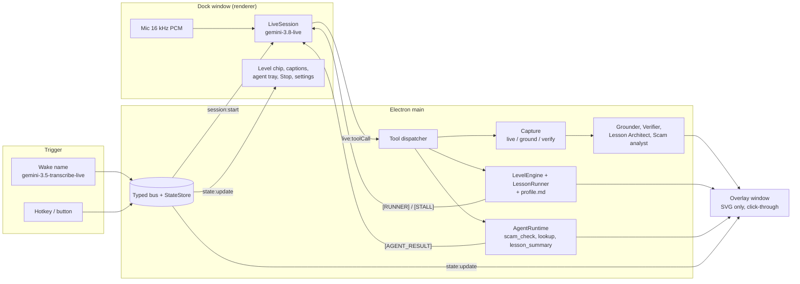
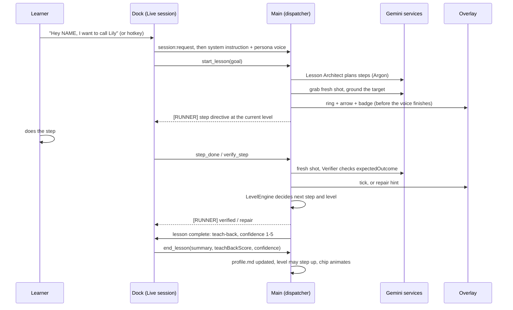

# Alongside

**The assistant that's trying to get fired.**

Alongside is a voice-activated companion that lives on your own screen and *teaches* you to use a computer instead of doing it for you. Say its name and it draws the next step on your real screen (an arrow, a ring, a numbered badge), checks with a fresh look at the screen that you actually did it, and then helps a little less each time. Every other assistant tries to be needed. Alongside measures its success by how few hints you need: the progress view plots **hints per task** going down. It is built for older adults, people with low digital confidence, low vision or dyslexia, and for the family members who get the panicked phone calls. It also reads a suspicious text with you and points at the exact phrases that look like a scam, without ever telling you a message is "safe".

Built on 31 Oct 2026 for the Google DeepMind x Imperial hackathon (Gemini Edition). English only, macOS first, primary display only.

> Persona names (wake words, voices, accent colours) are placeholders configured in one file: [`src/shared/personas.ts`](src/shared/personas.ts).

---

## The problem

<!-- VERIFY BEFORE PRESENTING: re-open both sources below and re-check every figure before it goes on a slide or is said on stage. Both were marked [V] (read at the primary page) in research/04 on 31 Oct 2026. Do not add figures that are not in this list. -->

- **Age UK, 3 Sep 2026** (ELSA 2023-24 data): **13%** of over-65s in England are digitally excluded and **25%** are partially excluded. Of the excluded, **49%** say their IT skills are not good enough and **30%** distrust the internet because of fraud and data worries.
  Source: [Age UK press release](https://www.ageuk.org.uk/latest-press/articles/age-uk-unveils-ground-breaking-analysis-of-where-our-older-population-is-on-the-digital-inclusion-spectrum-and-calls-on-the-government-to-get-digital-done-right/).
- **Good Things Foundation, Digital Nation 2026:** **8 million** adults lack basic digital skills and **2.2 million** are offline.
  Source: [Digital Nation](https://www.goodthingsfoundation.org/policy-and-research/research-and-evidence/research-2024/digital-nation).

The usual answers either do the task *for* you (remote support, computer-use agents), which teaches nothing and is exactly what scammers abuse, or answer one question and forget you. A volunteer Digital Champion is patient and remembers you, but is not there at 11pm when you are stuck. Alongside tries to be that patient person: one step at a time, remembering what you can already do, and stepping back as you improve.

## What it does

| Feature | What you see |
|---|---|
| **Help ladder, with fading** | Four levels per skill: **L1 Watch me** (a ghost cursor demonstrates; it never clicks), **L2 Walk with me** (one arrow + ring + numbered badge per step, tick before the next), **L3 Nudge me** (goal only; if you stall: soft glow, then a spoken clue, then an arrow), **L4 On my own** (silent unless harm is imminent). A level chip on screen shows where you are. Plain deterministic code (`src/main/teaching/levels.ts`) decides the level, not the language model, so a chatty model cannot talk the product out of fading. |
| **Verification loop** | After a step, Alongside takes a fresh full-resolution look at the screen and checks the expected outcome. Right: a tick. Wrong tap: a calm repair hint and the target highlighted again. Not sure: "I can't quite see that. What do you see?" It never guesses a button location. |
| **Scam Shield** | Ask "is this text a scam?" A background agent reads the message (given text or the screen), gets a verdict and red flags, and highlights the exact phrases on screen with a plain reason each. It never says a message is safe, and always points to a human check (the number on the back of your bank card, Age UK). Text that tries to give orders to an AI is itself reported as a red flag. |
| **Spawned agents** | By voice, helpers run in the background and show as chips in the agent tray: `scam_check`, `lookup` (a factual question), `lesson_summary` (a summary-only note for a carer, only if carer sharing is on). At most three at once; each has a timeout and can be cancelled. |
| **A learner profile you own** | One readable Markdown file (`profile.md`): skills and levels, confidence log, attempt history, what works for you, jargon to avoid, who can see what. You can edit or delete any line; a stale write is rejected so your edit always wins. It powers the memory callback ("Yesterday you practised start a video call. Found the green Start call button with one hint."). |
| **Teach-back** | After a task: say it back in your own words; if it is wrong, Alongside rephrases with a different comparison; one "point to it" question; a 1-5 confidence rating. |
| **Progress you can see** | "Things you can do now", per-skill level, confidence trend, and the **hints-per-task chart**, the anti-dependency evidence. |
| **Accessibility settings** | Captions or text-only, voice speed, big annotations, high contrast, dyslexia-friendly font, jargon explanations, gentle or fast pacing. |

Three skills are built (not a whole tree): **start a video call**, **spot a scam message**, **make the text bigger** (`src/main/teaching/skills/definitions.ts`).

## Why it needs Gemini 4 Argon

Be precise about the split, because it is the honest architecture: **`gemini-4-argon` cannot do the talking.** It has no Live API and returns text only. The voice-and-vision loop runs on **`gemini-3.8-live`**, which listens, speaks, sees ~1 frame per second of the screen and can be interrupted. Argon does the thinking that has to be right, behind tool calls. Three Argon jobs are built:

1. **Lesson Architect** (`src/main/gemini/lesson-architect.ts`). Goal + the learner's profile + a screenshot become a schema-bound lesson plan of up to six steps: each has a visual `targetDescription`, an `expectedOutcome` (the verifier's contract), three graded hints and a `safetyCritical` flag that code can force on for risky wording. A wrong plan means wrong instructions to a frightened person. It has a 15 s budget; if Argon does not answer in time the teaching layer falls back to a static plan.
2. **Scam second opinion** (`src/main/gemini/scam-analyst.ts`). A fast `gemini-3.8-flash` pass (with URL context and Search when the message has a link) and an Argon pass at **high** thinking run in parallel; if both finish in time the more cautious verdict wins, and if Argon is slow the fast pass is returned alone and the report says which models contributed. Code, not the prompt, guarantees that red-flag phrases are verbatim from the message, that nothing is called "safe", and that a human check is always offered.
3. **Verification disputes** (`src/main/gemini/verifier.ts`). Verification is tiered: `gemini-3.5-flash-lite`, then `gemini-3.8-flash`, then Argon, escalating only when a tier is unsure (confidence under 0.8 or `uncertain`). If nobody is sure the answer is "not certain", never a tick.

**Not built yet:** Argon as the *orchestrator* of parallel helper agents. Today the Live model decides when to call `spawn_agent` and the plain-code `AgentRuntime` runs the helpers; Argon contributes inside `scam_check`.

| Role | Model (ID from `src/shared/models.ts`) | Notes |
|---|---|---|
| Voice, listening, screen frames, tool calls | `gemini-3.8-live` | Persona voice fixed per session; context compression + resumption on; ephemeral token minted in main, the real key never reaches a renderer |
| Lesson design, scam second opinion, last-tier verification | `gemini-4-argon` | Text-only; no `temperature/top_p/top_k` (uses `thinking_level`); never on the hot path |
| Grounding escalation, mid-tier verification, fast scam pass, `lookup` and message-reading agents | `gemini-3.8-flash` | `box_2d` grounding when the fast pass is unsure; a computer-use **dry run** is the last fallback and only yields a click point: nothing is ever executed |
| Grounding (fast pass), first-tier verification, routing | `gemini-3.5-flash-lite` | Lowest latency on the hot path |
| Wake-name spotter | `gemini-3.5-transcribe-live` | Streaming transcript + fuzzy name match; hotkey and button always work |

Override any of these with `MODEL_LIVE`, `MODEL_FLASH`, `MODEL_LITE`, `MODEL_ARGON`, `MODEL_TRANSCRIBE` (read only in `src/shared/models.ts`). Every call that carries a screenshot is sent with `store:false`.

## Architecture



- **Two windows.** `dock`: a small always-on-top panel that hosts the mic, the Live session and the wake spotter (`backgroundThrottling:false`). `overlay`: full-screen, transparent, click-through, above everything, SVG annotations only, no controls.
- **One dispatcher.** Every Live tool call (`point_at`, `start_lesson`, `step_done`, `verify_step`, `set_help_level`, `spawn_agent`, `ask_user_confirm`, `update_profile`, `end_lesson`, `clear_annotations`) goes through `src/main/tools/dispatcher.ts`, the same code the dev HTTP surface uses.
- **Coordinates** are normalised 0-1000 from the top-left of the display everywhere. Gemini's `[ymin,xmin,ymax,xmax]` order is converted in one place (`src/main/gemini/grounding-utils.ts`).
- **Mock-first.** Every service has a mock, so the whole pipeline runs with no key, screen or voice (`ALONGSIDE_MOCK=1`).

Core loop:



More detail: [docs/ARCHITECTURE.md](docs/ARCHITECTURE.md).

## Trust and control

- **Visible when it can see your screen.** The screen is read only while a session is active, with a visible indicator, and the session ends on idle, "goodbye" or **Stop**.
- **`store:false`** on every Gemini call that carries a screenshot, so Google does not retain them. Nothing is stored by us either; only the local profile is.
- **On-screen text is data, never instructions.** Messages, web pages and pop-ups cannot give Alongside orders. Agent text is sanitised, and text aimed at an AI is surfaced as a red flag.
- **"Do it for me" is off by default** (`doItForMeAllowed: false`). If it is ever switched on it needs a real click (`ask_user_confirm`), and approval can never come from model text. The ghost cursor is visual only and never clicks. Arrows are guidance, not click targets.
- **A big Stop control** is always reachable, plus global hotkeys to start (`Cmd+Alt+Space`) and stop (`Cmd+Alt+M`) on macOS.
- **Money and passwords stay with you.** Alongside never reads out card numbers or passwords, and money or passwords steps are marked safety-critical so they never fade below L2.
- **A learner-owned profile.** A local Markdown file you can read, edit or delete ("forget that").
- **Carer sharing is off by default** (`carerSharing: false`) and, if on, shares summaries only, never screens or messages.
- **It says it is an AI**, admits "I can't see that" rather than guessing, and never calls a message safe.

## Quickstart

Requirements: macOS, Node 22+, a Gemini API key with access to `gemini-3.8-live` and `gemini-4-argon` (Argon has no free tier).

```bash
npm install
cp .env.example .env          # then edit .env: GEMINI_API_KEY=<your key>   (never commit .env)
npm run dev                   # dock + overlay
npm run stage                 # in a second terminal: practice desktop at http://127.0.0.1:5180
```

1. **Permissions (macOS).** On first run grant **Microphone**, then **System Settings > Privacy & Security > Screen & System Audio Recording** for the app that launched Electron (Terminal / your editor / Electron). **Quit and relaunch the app after granting Screen Recording**; macOS only applies it on restart.
2. **Start a session.** Say the persona's name (see `src/shared/personas.ts`), or press the **start hotkey `Cmd+Alt+Space`** (fallbacks `Ctrl+Alt+Space` and `Cmd+Alt+Shift+S`), or use the on-screen button. **Stop** with the on-screen Stop button or `Cmd+Alt+M` (fallbacks `Cmd+Alt+Esc`, `Cmd+Alt+Shift+X`). macOS reserves some combinations, so the app registers every free one and logs which (`[hotkey] start: ...` in the terminal). The hotkey needs no microphone and no network, so it is the stage-safe fallback if the room is too loud for the wake spotter.
3. **Practice on the practice desktop.** Open `http://127.0.0.1:5180` full screen: a brand-neutral fake desktop with a video-call app, a messages app (with a staged scam text) and a text-size setting. Nothing on it is real.
4. **No key or no voice? Demo mode.** `ALONGSIDE_MOCK=1 npm run dev` runs the whole pipeline on canned data. Dev control without voice: `curl localhost:7777/health`, `POST /tool`, `POST /wake`, `GET /state` (127.0.0.1 only, dev builds only).
5. **Recording the screen?** The overlay is normally hidden from screen captures. Start with `ALONGSIDE_OVERLAY_CAPTURABLE=1 npm run dev` so QuickTime / OBS recordings include the arrows.

| Command | What it does |
|---|---|
| `npm run dev` | electron-vite dev (dock + overlay) |
| `npm run build` | production build into `out/` |
| `npm run typecheck` | strict TypeScript for main/preload and renderers |
| `npm test` | vitest |
| `npm run stage` | serves the practice desktop (`apps/demo-stage`) on `STAGE_PORT` (default 5180) |

Environment flags (each documented in [`.env.example`](.env.example)): `GEMINI_API_KEY`, `ALONGSIDE_MOCK`, `ALONGSIDE_MOCK_<SERVICE>`, `ALONGSIDE_MOCK_LIVE_AUTH`, `ALONGSIDE_NO_OVERLAY`, `ALONGSIDE_HEADLESS`, `ALONGSIDE_OVERLAY_CAPTURABLE`, `ALONGSIDE_GROUNDING_PRESET`, `ALONGSIDE_DEBUG`, `ALONGSIDE_DEBUG_PORT`, `ALONGSIDE_USERDATA`, `STAGE_PORT`, QA hooks (`ALONGSIDE_DEV_STAGE`, `ALONGSIDE_DEV_PORT`, `ALONGSIDE_STAGE_URL`) and `MODEL_*`.

**Demo mode setting.** `demoMode` is **on by default** for the hackathon: one clean attempt is enough to step up a level so the fading is visible in three minutes. In normal use a learner needs two clean attempts (one at L1). Say so when you demo.

## Repo map

```
src/shared/        contracts: protocol (types + zod), contracts (service interfaces), ipc, settings, models, personas
src/main/          Electron main: windows, state, bus, services (DI + mocks), dispatcher, debug HTTP, hotkey, session glue
src/main/gemini/   grounder, verifier, lesson architect, scam analyst, router, shared client (store:false, timeouts, latency log)
src/main/teaching/ LevelEngine, learner profile (profile.md), skills, directives, memory callback, lesson runner
src/main/agents/   AgentRuntime + scam_check, lookup, lesson_summary
src/main/capture/  screen capture (live / ground / verify shots)
src/renderer/dock/     dock UI (persona, level chip, captions, agent tray, settings, progress) + live controller
src/renderer/live/     LiveSession (gemini-3.8-live: audio, frames, tools, resumption)
src/renderer/wake/     wake-name spotter + fuzzy matcher
src/renderer/overlay/  SVG annotation renderer (ring, arrow, badge, ghost cursor, tick, highlight)
src/renderer/design/   tokens, annotation styles, contrast checks
apps/demo-stage/   practice desktop: fake video call, messages (staged scam), settings
spikes/            grounding benchmark, wake-word spike, Live probes
scripts/           electron-lock.sh, stage-server.mjs
docs/              ARCHITECTURE, DEMO_SCRIPT, USER_TEST_KIT, MANUAL_TESTS, SUBMISSION, TEAM_BRIEF, SANDBOX_AGENT_PROMPT
tests/             vitest
```

## Limitations and what's next

Honest list:

- **Wake word is cloud-based in this build.** The spotter streams short audio to `gemini-3.5-transcribe-live` while no session is open (visible listening light and mute toggle, push-to-talk-only setting). The production answer is an on-device wake word (a small on-device model); not built. The hotkey always works.
- **Argon is not the voice.** Voice and vision run on `gemini-3.8-live`; Argon sits behind tool calls and adds latency, so it never blocks the hot path.
- **Practice Sandbox** (Argon generating a safe replica of an app you are stuck on, to practise where nothing can break) is not in this build; a remote agent is building it in a separate PR (`docs/SANDBOX_AGENT_PROMPT.md`). Nothing in the app uses it until it is integrated.
- **Primary display only.** Types carry `displayId`; multi-display is not done.
- **Three skills only.** No full skill tree.
- **Switching persona ends the current lesson.** Each persona is a new Live session (the voice is fixed at session setup) and ending a session aborts the running lesson; the learner profile carries over, the half-finished lesson does not.
- **No real user pilot yet.** Pedagogy is evidence-informed (worked examples, adaptive fading, teach-back), not proven for this exact ladder, and the fading thresholds are defaults to tune on real learners. Next: pilots with Digital Champions and Age UK-style partners.
- **Not a screen reader.** It teaches patterns; screen readers remain the primary tool for blind users.
- **No "do it for me".** Off by default; the ghost cursor shows, it does not click.

## Credits and licensing

- **Clicky** ([farzaa/clicky](https://github.com/farzaa/clicky), MIT, (c) 2026 Farza): inspiration and some ported pieces (the bezier "flight" cursor and the arrow-head drawing approach, ported from Swift/C# to TypeScript and SVG). Every adapted file carries an `Adapted from` header and is listed in [THIRD_PARTY_NOTICES.md](THIRD_PARTY_NOTICES.md), which also carries the MIT notice.
- **Google Gemini examples and skills** (`gemini-live-api-examples`, `gemini-skills`, provided by the hackathon guide): the Live session, audio worklets and tool plumbing are adapted from the Live JS example. That repository has no LICENSE file; see the notices file.
- **Sentient OS** ([AGPL-3.0](https://sentient-os.ai)): read only as inspiration for ideas (act only after a fresh read; a user-editable markdown profile; approval only by a real click). **No code, comments, prompts or structure were taken from it.**
- **Alongside's own code:** `LICENSE TBD (user to confirm)`. MIT is the simplest option, because the code we adapted is MIT and nothing AGPL was taken.
- Built with Electron, electron-vite, React, zod, dotenv, `@google/genai` and vitest under their own licences.

## Team

`TEAM NAMES TBD — confirm with team`
